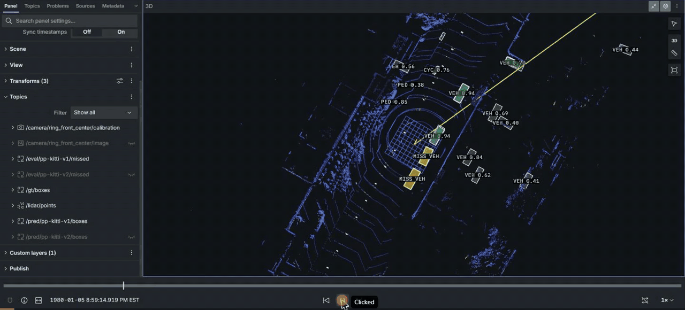

# perception-replay-eval: replay driving logs, recompute perception, evaluate regressions

<p align="center">
  <a href="reports/media/foxglove_review.mp4">
    
  </a>
  <br>
  <sub>Foxglove replay of AV2 scene <code>2e3f2ae7</code>: <b>v1</b> (forward-only) misses whole rows of cars beside and behind the ego (orange),
  then <b>v2</b> (360°) finds them but adds false positives (red). Clicking a box shows the <code>gt_id</code> / <code>pred_id</code> and
  <code>status</code> that key into <code>matches.parquet</code>. <a href="reports/media/foxglove_review.mp4">Full-quality MP4</a>.</sub>
</p>

Take logged driving data, re-run a detector over it as a recompute job, and get **auditable**
metrics and a **Foxglove-viewable MCAP** out the other end. It's the replay → recompute → evaluate →
visualize loop, small enough to read in an afternoon.

```
 AV2 S3 (public)        Parquet lake                    Ray (1 task / scene)          eval tables              review
 ───────────────  ──▶  frames / lidar /   ──────────▶  PointPillars @ model X  ──▶  matches.parquet   ──▶  MCAP: lidar + camera
 lidar, poses,         annotations /                  → predictions/<X>.parquet     (1 row / box)          + GT + preds (TP/FP)
 GT cuboids, camera    calibration                                                   metrics_* / tracking    + missed GT
                       + base MCAP                                                   regression report      + BEV video
```

* **Data:** 4 scenes from the [Argoverse 2 Sensor](https://www.argoverse.org/av2.html) val split, about 630 lidar
  sweeps and 73k GT cuboids, with logged timestamps and GT kept exactly as recorded.
* **Model:** the public PointPillars KITTI checkpoint ([zhulf0804/PointPillars](https://github.com/zhulf0804/PointPillars), MIT),
  ported to pure PyTorch (no CUDA build step) and verified against the KITTI demo frame in `tests/`.
* **Two model versions** share that checkpoint with different shipped inference recipes (`configs/pipeline.yaml`):
  `pp-kitti-v1` is a single forward pass. `pp-kitti-v2` adds 360° coverage via 4 rotated passes and 3-sweep accumulation.
* **Metrics:** AV2-style center-distance AP (0.5/1/2/4 m) per class × distance bucket × scene, ATE/ASE/AOE,
  per-frame TP/FP/FN, CLEAR-MOT tracking (MOTA, ID switches). Every number is a group-by over
  `matches.parquet`, and every row there names a frame (`log_id`, `timestamp_ns`) and a box (`gt_id` / `pred_id`).

## Run it (one command)

Requires [uv](https://docs.astral.sh/uv/) and `ffmpeg` only for the optional video. About 1 GB download and 3 GB disk.

```bash
git clone https://github.com/Sanjiv01/perception-replay-eval && cd perception-replay-eval
uv run replay all
```

That downloads the 4 logs anonymously from S3, builds the lake, runs both model versions through Ray,
evaluates, writes MCAPs to `data/mcap/` and reports to `reports/`. It takes about 15–25 min on a laptop CPU
and is resumable: rerun the same command after an interruption and finished scenes are skipped.

Faster smoke run: set `dataset.max_frames: 30` in `configs/pipeline.yaml`. On a machine with a
stable CUDA GPU, set `recompute.device: cuda` (results match the CPU run; it's only faster).

### Stages (each is also its own command)

| command | reads | writes |
|---|---|---|
| `replay scout` | S3 listing | class counts per val log (to choose scenes) |
| `replay download` | S3 | `data/raw/<log>/…` byte-for-byte AV2 files |
| `replay ingest` | raw | `data/lake/{frames,annotations,calibration}.parquet`, `lidar/log_id=*/`, base MCAP |
| `replay recompute [--models …]` | lake | `data/lake/predictions/<model>.parquet` + `.manifest.json` (ckpt sha, config hash, latency) |
| `replay evaluate` | lake + predictions | `data/lake/eval/<model>/{matches,metrics_*,tracking_*}.parquet`, `reports/eval_<model>.md` |
| `replay export` | everything | `data/mcap/<log>.mcap` with GT + predictions + eval status |
| `replay regress A B` | eval tables | `reports/regression_A_vs_B.md` + slice/flip parquet |
| `replay trace <model> --cls X --bucket Y --status FN` | eval tables | prints reasons → frames → boxes → Foxglove seek time |
| `replay render <log>` | everything | `reports/media/review_<log>.mp4` (BEV, both models side by side) |
| `python scripts/make_demo.py` | reports | `reports/media/demo.mp4` (40 s walkthrough) |

## Look at it in Foxglove

**Screen recording:** [`reports/media/foxglove_review.mp4`](reports/media/foxglove_review.mp4) (50 s, Foxglove web app):
v1 top-down with missed rows behind the ego, click-through to a GT box's `gt_id`, then v2 with a false positive's
`pred_id` / `status: FP`.

Open `data/mcap/<log_id>.mcap` in the Foxglove desktop app, or stream it into the web app without uploading anything:

```bash
uv run python scripts/serve_mcap.py data/mcap 8765      # localhost-only, CORS + HTTP Range
# then open: https://app.foxglove.dev/<your-org>/view?ds=remote-file&ds.url=http%3A%2F%2F127.0.0.1%3A8765%2F<log_id>.mcap
# (Chrome asks once to allow "local network access" for app.foxglove.dev)
```

Add a **3D** panel (display frame `base_link`, 2D top-down, distance ≈ 75 m):

| topic | what | colour |
|---|---|---|
| `/lidar/points` | sweep, ego frame | colour by `intensity` |
| `/gt/boxes` | logged GT cuboids | green (evaluated classes), grey (others) |
| `/pred/<model>/boxes` | predictions | **blue = TP**, **red = FP** |
| `/eval/<model>/missed` | GT the model missed | **orange = FN** |
| `/camera/ring_front_center/image` | front camera, with calibration | add an **Image** panel |

Click any box: its metadata (`gt_id` / `pred_id`, score, status, matched id, center error) is the
primary key of a row in `matches.parquet`.

## Reading the results

* `reports/eval_<model>.md`: metrics per class/bucket/scene, FP/FN reason breakdown, tracking.
* `reports/regression_pp-kitti-v1_vs_pp-kitti-v2.md`: what got worse and better, box-level flips, worst frames.
* `docs/DISCREPANCY.md`: one surprising number traced end to end, written for a model owner.
* `docs/UX_BACKLOG.md`: tooling gaps hit while building this, as backlog items.
* `reports/media/foxglove_review.mp4`: Foxglove screen recording (v1 vs v2 overlays, box metadata).
* `reports/media/demo.mp4`: 40 s walkthrough (pipeline → regression → trace → root cause → BEV playback).

## Results on the 4 committed scenes

628 frames, about 11k vehicle / 6.7k pedestrian / 324 cyclist GT objects after ROI and range filters.
mAP is the mean of AP at 0.5 / 1 / 2 / 4 m. P and R are precision and recall at the 2 m TP threshold.

| version | recipe | VEHICLE mAP (P / R) | PEDESTRIAN mAP | CYCLIST mAP | vehicle MOTA |
|---|---|---|---|---|---|
| `pp-kitti-v1` | 1 forward pass | 0.350 (0.91 / 0.37) | 0.115 | **0.589** | 0.319 |
| `pp-kitti-v2` | 4 rotated passes + 3 sweeps | 0.632 (0.75 / 0.73) | **0.303** | 0.130 ⚠ | 0.477 |
| `pp-kitti-v2-rot` *(ablation)* | 4 rotated passes | **0.690** (0.79 / 0.74) | 0.258 | **0.665** | **0.551** |
| `pp-kitti-v2-sweeps` *(ablation)* | 3 sweeps | 0.319 (0.89 / 0.36) | 0.113 | 0.073 | — |

**What the regression report says:** v2 is a big win for vehicles and pedestrians, but cyclists
collapse (−0.46 mAP, concentrated in scene `2e3f2ae7` at 0–20 m). The cause is 541 pedestrians
classified as cyclists. The ablation shows sweep stacking alone causes it, so the recommended version is
**v2-rot**: it regresses only one small slice. The full trace is in [`docs/DISCREPANCY.md`](docs/DISCREPANCY.md),
including how a 20-point "precision drop" turned out to be the evaluator scoring unlabelled parked cars.
The ROI fix that came out of it is now the default.

Committed outputs from this run: [`reports/`](reports/) (eval + regression markdown, `before_roi_fix/` for
the pre-fix numbers) and [`reports/media/review_2e3f2ae7.mp4`](reports/media/review_2e3f2ae7.mp4) (BEV, v1 vs v2).
Latency in the manifests depends on device: v1 ran on GPU (42 ms/frame), the others on CPU after
the GPU-driver crashes described below (1.2–1.4 s/frame for 4 rotated passes).

## Layout

```
configs/pipeline.yaml     scenes, model versions, eval + tracking params, resource caps
src/replay/
  download.py ingest.py   S3 → raw → Parquet lake (+ integrity checks on timestamps/poses)
  detector/               pure-torch PointPillars + model-version wrapper (frames, rotations, sweeps)
  recompute.py            Ray job, per-scene checkpointing, host-safety admission control
  evaluate.py tracking.py matching, AP, reason codes, CLEAR-MOT
  regression.py trace.py  version diff and metric → frame → box drill-down
  mcap_io.py render.py    Foxglove MCAP writer, BEV video
tests/                    metric unit tests + port-correctness test on the KITTI demo frame
```

## Design notes and honest caveats

* **The detector is KITTI-trained**, so it knows Car / Pedestrian / Cyclist only, which map to AV2
  `REGULAR_VEHICLE`, `PEDESTRIAN`, `BICYCLIST|MOTORCYCLIST`. Trucks, buses etc. aren't evaluated, and
  predictions landing on them are labelled `unevaluated_category` rather than silently counted as background FPs.
* Domain adaptation is limited to what an inference recipe can do: shift points by the KITTI sensor height
  (1.73 m) and rescale intensity 0–255 → 0–1. Numbers are therefore far below AV2 leaderboard models.
  The point of this repo is the loop and its auditability, not the score.
* The original repo's CUDA voxelization and rotated NMS are reimplemented (torch / shapely). Box conventions
  (mmdet3d-v0: `yaw = −θ − π/2`, z at box bottom) were verified against matched AV2 GT.
* Matching is greedy by score on BEV center distance, like the AV2 detection eval. Predictions and GT
  beyond 50 m are dropped, and GT with 0 lidar points is not evaluated.
* Ray runs with explicit caps (`recompute.max_cpus` = 90% of cores, admission only while ≥10% RAM is free
  and GPU < 85 °C) and defaults to CPU. On the dev laptop, concurrent CUDA contexts crashed the GPU driver
  (`VIDEO_TDR_FAILURE`), see `docs/UX_BACKLOG.md` #6–7.

Data: Argoverse 2 is © Argo AI, CC BY-NC-SA 4.0. It is downloaded at runtime and not redistributed.
See `THIRD_PARTY_NOTICES.md`.
